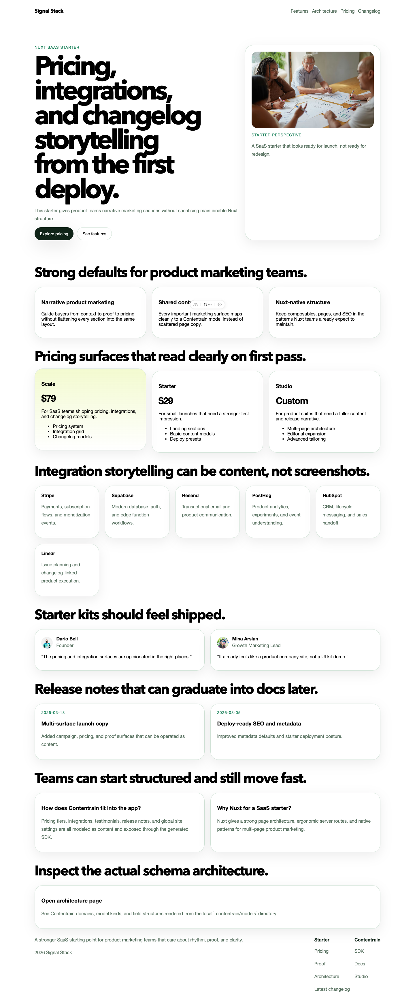
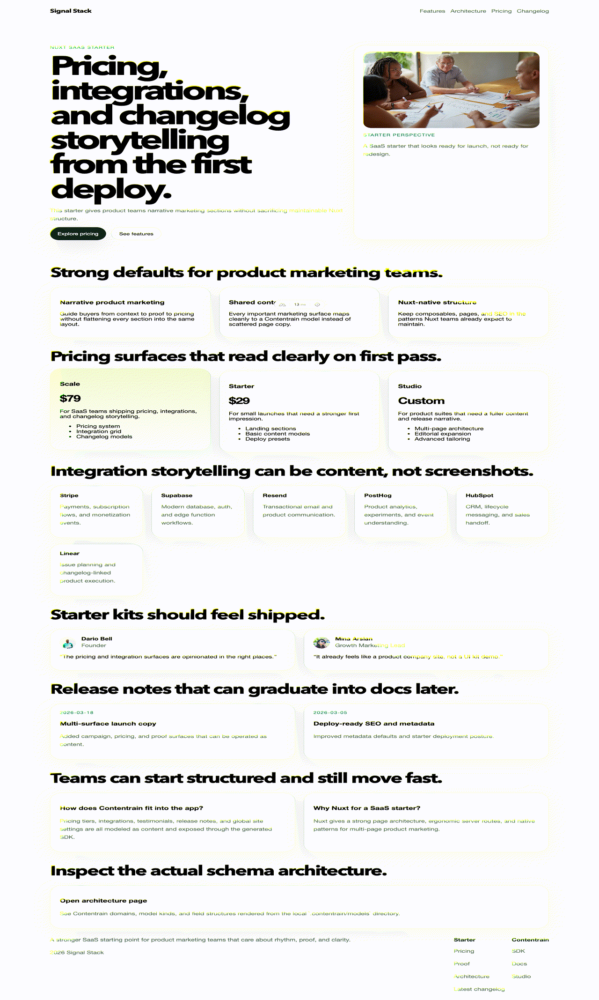

<p align="center"></p>

# Contentrain Nuxt SaaS

A Nuxt 4 starter for a SaaS marketing site: hero, features, pricing, integrations, testimonials, FAQ and a changelog. All of it is content in `.contentrain/`, with nothing hard-coded in the pages.

It is built on [Contentrain](https://ai.contentrain.io), the content governance ecosystem for teams and AI agents. Here is how that works in this starter:
- Content, schemas and the generated typed client live in git next to the code.
- Every change is reviewable.
- AI agents edit content through the same validated models as people do.





## What it shows

- **Server-only content reads.** Nitro routes in `server/api/` query the generated `#contentrain` client. Pages load the data with `useAsyncData`, as the [Nuxt guide](https://ai.contentrain.io/guides/frameworks#nuxt-3) recommends.
- **Collections, singletons and documents.**
  - Pricing tiers, features, integrations, testimonials and FAQ are collections.
  - Hero, navigation, footer, SEO and site settings are singletons.
  - Changelog entries are Markdown documents, with a real route at `/changelog/[slug]`. An unknown slug returns 404.
- **A model overview.** `/architecture` lists the models by domain, read from `.contentrain/models`.

## Use this template

1. Click **[Use this template](https://github.com/new?template_name=contentrain-starter-nuxt-saas&template_owner=Contentrain)** to create your own repository.
2. Connect that repository to [Contentrain Studio](https://contentrain.io/studio). Your team can then edit, review and publish the content in the browser, while every change stays a git commit.

## Quick start

Requires Node 22 and pnpm 10.

```bash
pnpm install
pnpm dev
```

| Command | What it does |
|---|---|
| `pnpm dev` | Start the dev server |
| `pnpm check` | Type-check with `nuxt typecheck` |
| `pnpm build` | Production build |
| `pnpm preview` | Serve the production build |
| `pnpm contentrain:generate` | Regenerate `.contentrain/client` after you change models or content |
| `pnpm exec contentrain validate` | Validate models and content |
| `pnpm deploy:netlify` | Build with the Netlify preset |

Demo routes: `/`, `/changelog/multi-surface-launch-copy`, `/architecture`.

## Content model

Domains: `system`, `marketing`, `product`. Locale: `en`.

| Model | Kind | Domain | Fields |
|---|---|---|---|
| `footer` | singleton | system | `blurb`, `columns`, `legal_notice` |
| `navigation` | singleton | system | `announcement_label`, `cta_href`, `cta_label`, `items` |
| `seo-defaults` | singleton | system | `canonical_base`, `meta_description`, `meta_title`, `og_image` |
| `site-settings` | singleton | system | `default_locale`, `og_image`, `site_name`, `site_tagline`, `theme_name` |
| `faq-item` | collection | marketing | `answer`, `category`, `question` |
| `feature` | collection | marketing | `emphasis`, `icon`, `summary`, `title` |
| `hero` | singleton | marketing | `eyebrow`, `hero_media`, `primary_cta_href`, `primary_cta_label`, `secondary_cta_href`, `secondary_cta_label`, `subtitle`, `title` |
| `pricing-tier` | collection | marketing | `billing_hint`, `featured`, `features`, `name`, `price_label`, `summary` |
| `testimonial` | collection | marketing | `avatar`, `company_name`, `person_name`, `person_role`, `quote`, `rating` |
| `changelog-entry` | document | product | `release_date`, `slug`, `summary`, `title`, Markdown body |
| `integration` | collection | product | `category`, `icon`, `name`, `slug`, `summary` |

Models are in `.contentrain/models/` and content is in `.contentrain/content/`. After you edit either one, run `pnpm contentrain:generate`. That refreshes the typed client, which the server routes import as `#contentrain`.

## Deploy

- Netlify: the build command is `pnpm deploy:netlify` (set in `netlify.toml`). Nitro manages the publish directory.
- Netlify CLI: run `pnpm dlx netlify-cli init` to connect the repository for continuous deployment, or `pnpm dlx netlify-cli link` if the site already exists.
- Any Node host: run `pnpm build`, then `node .output/server/index.mjs`.

[](https://app.netlify.com/start/deploy?repository=https%3A%2F%2Fgithub.com%2FContentrain%2Fcontentrain-starter-nuxt-saas)

## Contentrain links

Contentrain has four parts: the open-source tools, Studio, Migrate and Bridge.

- Contentrain AI, MCP, CLI and SDK: [ai.contentrain.io](https://ai.contentrain.io)
- Query SDK: [ai.contentrain.io/packages/sdk](https://ai.contentrain.io/packages/sdk)
- Nuxt guide: [ai.contentrain.io/guides/frameworks#nuxt-3](https://ai.contentrain.io/guides/frameworks#nuxt-3)
- Contentrain Studio: [contentrain.io/studio](https://contentrain.io/studio)
- Open-source tools (MIT): [github.com/Contentrain/ai](https://github.com/Contentrain/ai)
- Migrate, WordPress to Astro: [migrate.contentrain.io](https://migrate.contentrain.io)
- Bridge, a free WordPress plugin that exports content as a Contentrain store: [github.com/Contentrain/wordpress-bridge](https://github.com/Contentrain/wordpress-bridge)

## License

MIT, see [LICENSE](./LICENSE).
